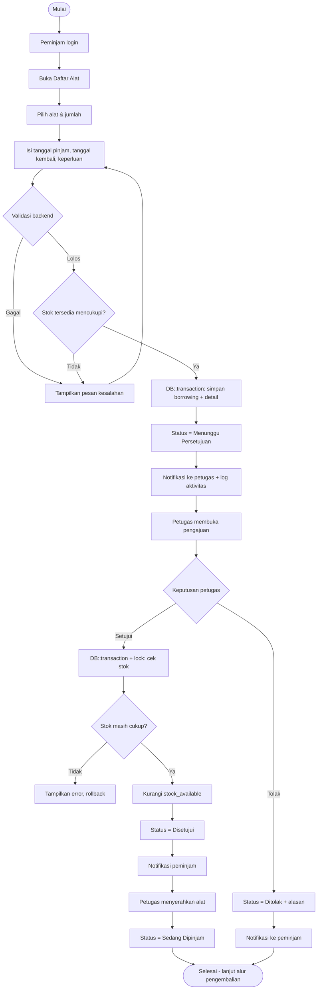

# Flowchart — Peminjaman Alat

## Aturan stok
- Stok dikurangi saat **persetujuan** (reservasi), bukan saat pengajuan.
- Menggunakan `DB::transaction()` + `lockForUpdate()` agar tidak terjadi peminjaman melebihi stok (race condition).
- Trigger `trg_tools_check_stock_before_update` mencegah stok negatif / melebihi total.