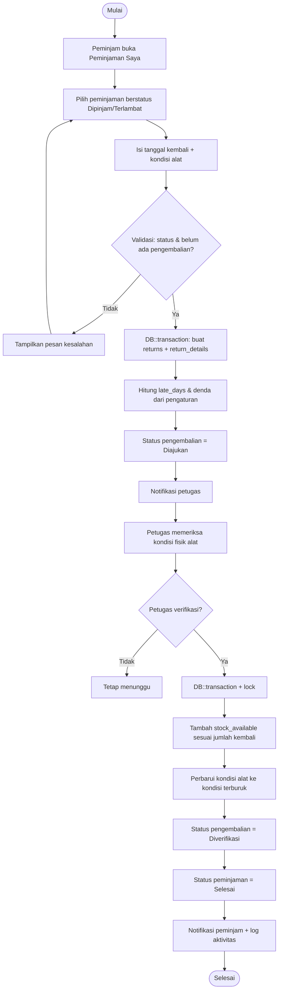

# Flowchart — Pengembalian Alat

## Perhitungan denda
- `late_days = max(0, return_date - due_date)`
- `fine_amount = late_days × fine_per_day` (hanya jika `fine_enabled = 1`)
- Nominal dan status aktif denda diatur Admin melalui menu **Pengaturan**.